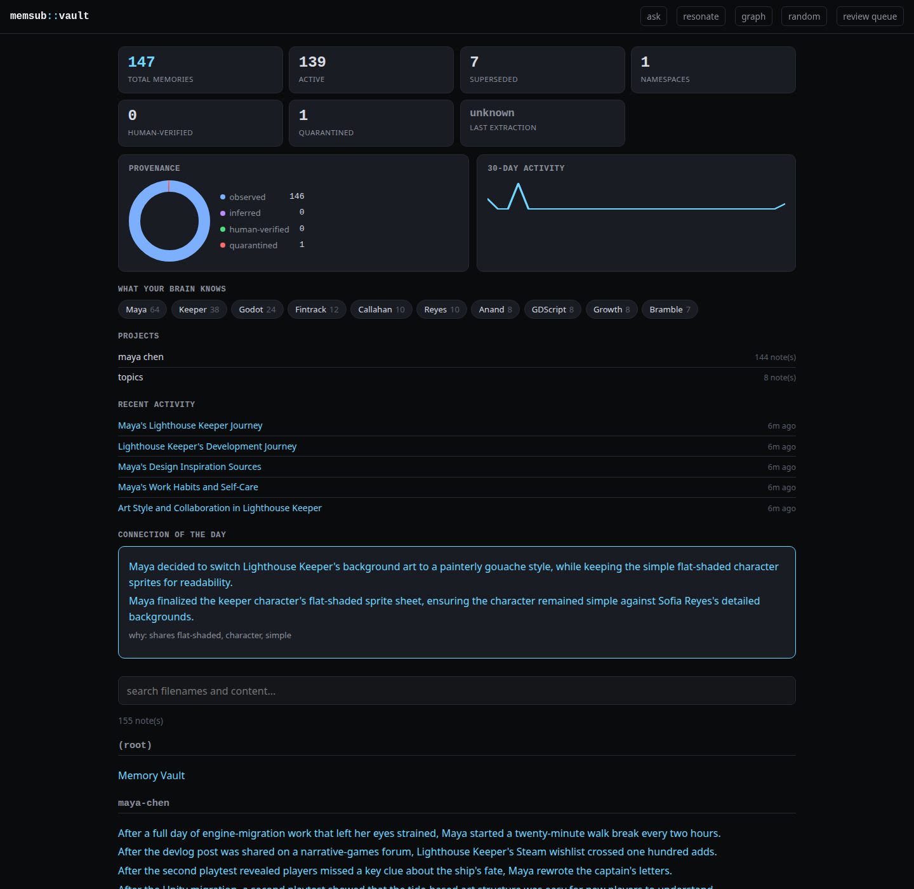

# memsub: local-first memory for AI agents, with receipts

**memsub is the only local-first agent-memory layer that publishes
reproducible memory-poisoning attack/defense numbers (98.7% attack success
undefended, 0% defended) via cryptographic write-channel provenance, and
runs the whole pipeline fully offline.**

## Why this matters

Every agent-memory system asks you to trust it: trust that what it recalls
is true, trust that a malicious or compromised input can't quietly rewrite
what your agent believes. Almost none of them measure that trust. memsub
does: it HMAC-signs every memory at write time with the code path that
actually produced it (a human said it, a model inferred it, or it was
imported), verifies that signature before letting one memory outrank
another, and quarantines anything that doesn't check out. Run the same
disguised-fact attack that beats a content-based defense 98.7% of the time,
and channel provenance drops it to 0%, on a documented, openly-scoped attack
class (the honest limits, including what this defense does *not* cover, are
in `docs/poisoning-provenance-2026-07-17.md` and `docs/poisoning-tiers-2026-07-19.md`).
And it does this on your machine: SQLite on disk, a local 8B model
(`qwen3:8b` via ollama) for extraction and consolidation, no API key, no
Docker, no vector database. Your memories, and the proof that they weren't
tampered with, never leave your computer.

## The problem

AI agents forget everything between sessions, and the fix everyone reaches
for (a hosted memory API, or a vector-DB-plus-Postgres self-hosted stack)
either sends your transcripts to someone else's server or requires standing
up infrastructure to remember five facts about your repo. Worse, almost
every memory system trusts whatever text it's given: a poisoned or
compromised input can look exactly like a genuine observation, and nothing
in the store can tell the difference after the fact.

## Architecture

memsub is a four-part decomposition, plus a web UI on top:

- **Store** (`memsub/store.py`): an append-only SQLite episodic store.
  Supersede and forget are recorded events, never row deletions, so every
  memory can answer "why do you exist and when were you used."
- **Extraction** (`memsub/extraction.py`, `backends.py`): raw conversation
  transcripts (JSONL or plain text, including Claude Code transcripts) become
  candidate memories via a local LLM, each carrying provenance (source, turn
  span, model, confidence).
- **Consolidation** (`memsub/consolidate.py`): an explicit offline pass that
  dedups near-identical memories, lets new facts supersede contradicted stale
  ones (LLM-judged, superseded copies kept for audit, never deleted), and
  forgets low-value memories by decay.
- **Hybrid retrieval** (`memsub/hybrid.py`): stemmed BM25 + dense embeddings
  + temporal/speaker/session signals, fused with reciprocal rank fusion,
  under a hard token budget. Dependency-free (no vector DB), measured with a
  dev/holdout protocol (see Results below).
- **Provenance** (`memsub/provenance.py`): every episode is HMAC-SHA256
  signed at write time with its channel (`user_stated`, `llm_inferred`,
  `imported`), keyed by a local secret (`~/.memsub/provenance.key`, 0600,
  never committed). Consolidation trusts the verified channel, never the
  memory's own content or `kind` field; a bad signature quarantines the row.
- **Web UI** (`memsub/vault_serve.py`): a unified dashboard over an Obsidian-
  style markdown vault export, five tabs: **Showcase** (the landing page),
  **Garden** (published evergreen notes), **Bridges** (cross-topic
  connections it noticed), **Blackbox** (the flight-recorder cockpit: what
  got consolidated, quarantined, staged), and **Loops** (dropped-work
  inbox). `memsub vault serve --vault <dir> --db <db>`.

See `docs/memory-design.md` for the full design and `LIMITS.md` for the
honest caveats behind every claim below.

## Quickstart

```bash
git clone <this repo> && cd memory-sublayer
uv venv .venv && uv pip install -p .venv/bin/python -e .
.venv/bin/python -m pytest -q   # all tests local, LLM/embedding calls mocked
```

Dependencies: numpy. That's the whole runtime dependency list.

Run the web UI on the public-safe demo brain (a fictional persona, Arjun
Mehta, an AI engineer building a cold-outreach product; regenerate it any
time with `scripts/build_demo_vault.py`):

```bash
.venv/bin/python -m memsub.cli vault serve --vault demo/vault --db demo/memory.db --port 8768
# open http://127.0.0.1:8768/
```

Try the poisoning benchmark yourself (no LLM cost, fully deterministic,
finishes in under a second):

```bash
.venv/bin/python scripts/poisoning_benchmark.py --provenance
```

See `docs/demo-runbook-2026-07-22.md` for a guided tour (dashboard, time
travel through a superseded fact, the morning brief, the belief-revision
ripple, self-editing with a human-approval gate).

## Use case: drop-in local memory for a Claude Code agent, over MCP

The concrete story: you wire memsub into Claude Code once, and your agent
remembers across sessions without you re-explaining your repo, your
preferences, or your decisions every time, and without any of that leaving
your machine.

```bash
claude mcp add memsub -- $(pwd)/.venv/bin/memsub mcp
```

That exposes four MCP tools to the agent: `add_memory`, `search_memory`,
`list_memories`, `forget_memory`. All memories land in `~/.memsub/memory.db`
(override with `MEMSUB_DB`); `MEMSUB_NAMESPACE` and `MEMSUB_AGENT` scope an
agent to its own namespace, so several agents can share one store safely.
Register it at user scope (`claude mcp add memsub -s user -- ...`) to make it
available to every session, not just one repo.

Why this beats the obvious alternative (re-pasting context every session, or
a hosted memory API): the agent's memory is a single SQLite file you own and
can inspect (`memsub audit <id>` shows exactly why any memory exists and
every time it was retrieved or injected), and it resists the specific attack
that a compromised input or a poisoned transcript would try: claiming to be
something it isn't. A malicious `add_memory` call can still write to the
store (memsub is append-only by design), but it enters through the
`imported` channel, cryptographically signed as such, and it can never
outrank or silently overwrite something you actually told the agent
yourself.

## Measured results (claim discipline: every number below traces to a report in `docs/`)

**LOCOMO** (Maharana et al. 2024), n=80 holdout slice, blind Sonnet judge.
Two separate claims, never fused into one number:

| condition | overall | single-hop | notes |
|---|---|---|---|
| memsub + frontier answerer (Sonnet CLI, budget 2000) | **63.75%** | 80.0% | beats mem0's independently **reproduced** ~61.7% (their own 2025 paper config, not their unreproduced 92.5 managed-platform claim) |
| memsub + fully local answerer (qwen3:8b) | **51.25%** | 80.0% | the only measured fully-offline number in this category; does **not** beat mem0's reproduced tier, never claimed to |

Full ladder and every deviation from the published protocol:
`docs/locomo-v3-2026-07-18.md`, `docs/locomo-frontier-v2-2026-07-18.md`.

**LongMemEval_S** (Wu et al., ICLR 2025), pre-registered n=30 (a second,
independently-authored benchmark, used as a cross-check, not a headline):

| condition | token-F1 | judge accuracy |
|---|---|---|
| memsub hybrid v2 | **0.2377** | 14/30 |
| naive top-k | 0.2063 | 15/30 (statistical tie with memsub) |
| no memory | 0.0788 | 1/30 |

Full protocol and deviations: `docs/benchmark-external.md`.

**Poisoning defense** (memsub's own synthetic harness, MPBench/MemPoison
metric vocabulary, one attack class, L1/L3a fully closed): disguised-fact
attack success rate **98.7% undefended -> 0% defended** via HMAC-signed
channel provenance, clean recall 0.0% -> 98.0% on the same run.
`docs/poisoning-provenance-2026-07-17.md`, tier extensions (L2/L3, with
honest partial results, not full wins) in `docs/poisoning-tiers-2026-07-19.md`.

**Latency and cost**: retrieval 2.8ms p95 warm over ~1450 memories (no LLM in
the search path), ~350 bytes/memory on disk, ~7s extraction per 28-turn
session on a local 8B model. `docs/metrics-local.md`.

**Synthetic recall under a hard token budget** (n=150 queries/cell, 5 seeds,
held-out): consolidation reaches 98.0% clean recall (correct fact injected,
no contradicting stale copy) at every budget 100-800 tokens; naive top-k
gets 0.0% clean because it packs every stale version alongside the fresh
one. `docs/benchmark.md`.

## What works, what doesn't, and the honest negatives

**What works**: local extraction/retrieval/answering end to end with zero
API key; hybrid retrieval measurably beats naive top-k and dense-only on
LOCOMO; consolidation's clean-recall win is large and reproducible; the
provenance defense is real, runnable, and byte-for-byte reproducible on
every rerun; the web UI runs on a real vault with real audit data.

**What memsub does not do**: it is not a hosted service, has no multi-tenant
anything, and namespace ACLs are accident-isolation between cooperating
local agents, not a security boundary against a process that can open the
SQLite file directly. The hashing embedder is dependency-free but not a
learned model, so absolute recall numbers are not competitive with
API-embedding systems; the `Embedder` protocol is the swap point if you want
one. Token budgets are a chars/4 approximation, not a real tokenizer.

**Honest negatives on record** (never hidden, because a system that only
reports its wins is not credible):

- **Write-time fact fusion is parked.** Consolidation's fusion phase has no
  channel-trust awareness at all (confirmed by direct code inspection, not
  just benchmark): it can synthesize a new memory from coordinated
  low-trust fragments regardless of their verified rank. In the one dataset
  shape tested, an independent upstream defense always caught the case
  before it mattered (0% promoted over a clean fact), but that is a property
  of that dataset, not proof the fusion phase itself is safe. See
  `docs/poisoning-tiers-2026-07-19.md`.
- **Sleep consolidation ships opt-in, with no performance claim.** The
  offline pass that writes session summaries and inferences did not improve
  answer quality on the holdout benchmark (0.143 vs 0.152 F1, a near-tie
  favoring the simpler path). It ships anyway on its safety merits: the
  observed-beats-inferred rule holds 98.0% clean recall under adversarial
  stale inferences where disabling it collapses to 0.0%. `docs/benchmark.md`.
- **Temporal retrieval is a statistical tie at n=20.** Surfacing session
  dates into context closed a real 15pp gap on the temporal category
  specifically, but it lives behind an eval-only `--with-dates` flag, not a
  library default, and was only measured on that one category in isolation.
  `docs/locomo-frontier-v2-2026-07-18.md`.
- **The mem0 comparison is scoped honestly.** memsub's frontier-answerer
  result beats mem0's *independently reproduced* number, not their
  unreproduced 92.5 managed-platform claim, and multi-hop questions still
  trail mem0's reproduced tier. Never say "beats mem0" without this
  qualifier.

## The web UI



Dashboard, search, readable notes with provenance, a knowledge graph of
entity links and supersede chains, a belief-revision ripple view, and a
review queue for human verdicts on AI-proposed edits. More screenshots in
`docs/screenshots/`.

## CLI

```bash
memsub extract session.jsonl               # transcript -> candidate memories
memsub consolidate --dry-run               # propose dedup/supersede/forget
memsub search "how do we run tests?"        # hybrid retrieval (default)
memsub audit --recent                      # what has memory been doing?
memsub audit <memory-id>                   # why does this memory exist?
memsub vault sync --vault DIR               # export to an Obsidian-compatible vault
memsub vault serve --vault DIR --db DB      # the web UI
memsub mcp                                  # the MCP stdio server
```

Full command reference: `GUIDE.md`.

## Local models (ollama)

```bash
ollama pull qwen3:8b            # extraction / consolidation (fast, local)
ollama pull nomic-embed-text    # optional real local embeddings
memsub extract session.jsonl --backend ollama --embedder ollama
```

`--backend auto` (the default) picks ollama automatically when a daemon
answers at `localhost:11434` and no `ANTHROPIC_API_KEY` is set. See
`GUIDE.md` for the full backend table (Anthropic API, ollama, the `claude`
CLI, and a deterministic mock used by tests).

## License

MIT, see `LICENSE`.

## Origins

This repo began as an AI-safety experiment on whether episodic memory
enables sustained deception (the Lying Game, preserved under
`experiments/lying-game/`). The audit-first design and the honest-negatives
discipline are inherited from it.
