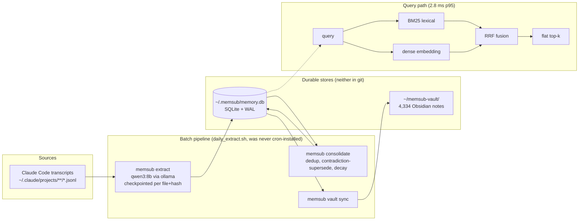
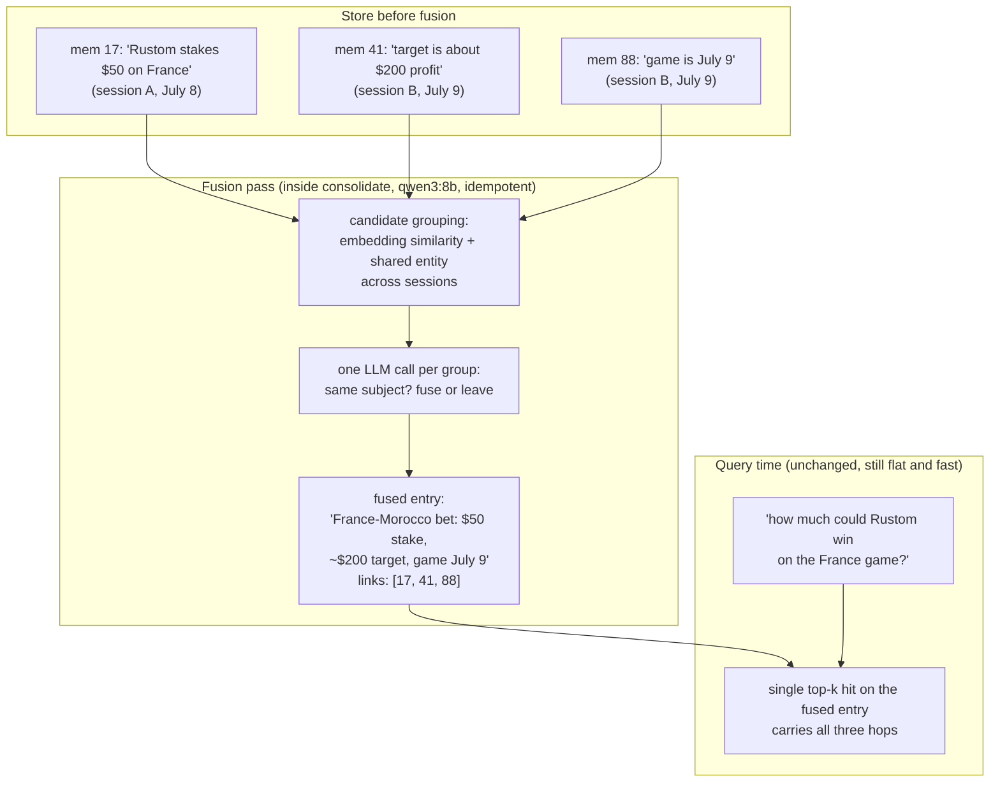
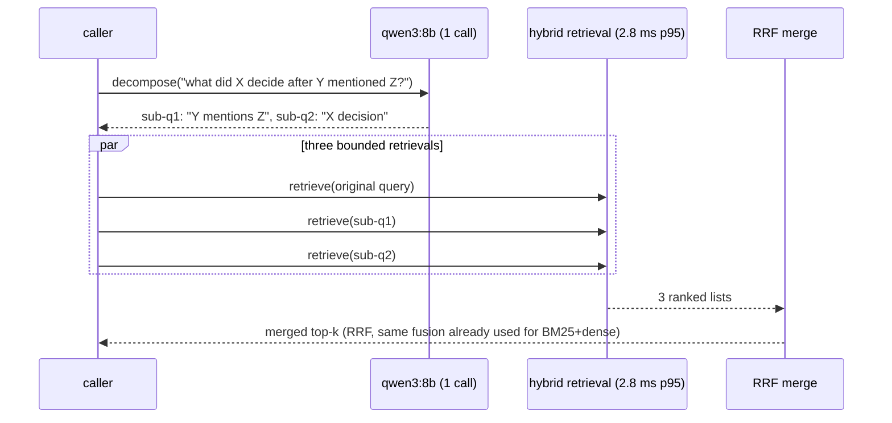
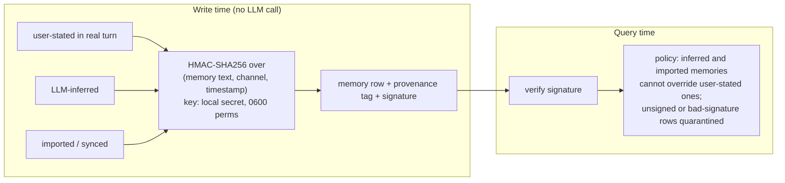
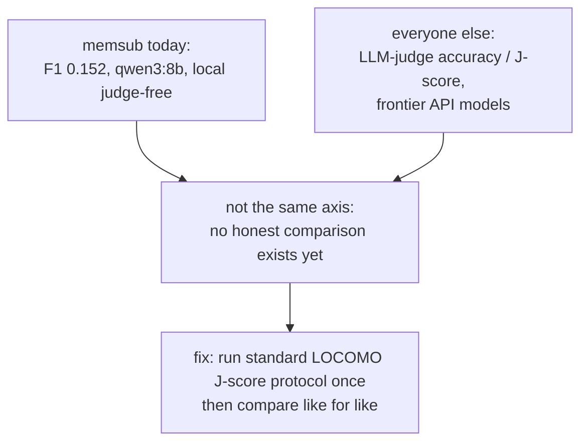

# memsub improvement plan: technical visuals (2026-07-17)

Companion to `improvement-plan-2026-07-17.md`. One diagram per improvement,
with the technical detail of what changes where. All diagrams are mermaid:
they render on GitHub and inside Obsidian.

## 0. Where memsub is today (baseline architecture)

Two structural facts drive everything below:

1. Durability depended on the expensive extract step running on schedule on a
   machine that is up. The crontab was never installed, so in practice it
   depended on someone remembering.
2. Retrieval is flat. A multi-hop question ("what did X decide after the
   conversation where Y mentioned Z?") needs facts that never co-occur in one
   chunk, and flat top-k has no mechanism to bridge them. That is the 94.6%
   multi-hop failure.

## 1. Durable capture: the fix for last night

Design principle (stolen from how mem0/Zep/Letta all split the same concern):
raw capture must be unconditional and near-free; LLM extraction stays batched
and expensive. Losing a session must be impossible even when ollama is down,
the extraction breaks, or the session is killed mid-run.

```mermaid
flowchart TB
    subgraph live["Live session (any repo, any machine on the NFS home)"]
        S["Claude Code session"]
        TR["transcript on disk<br/>~/.claude/projects/&lt;proj&gt;/&lt;session&gt;.jsonl"]
        S -->|"harness writes continuously"| TR
    end

    subgraph layer1["Layer 1: raw capture (no LLM, no network, seconds)"]
        H1["SessionEnd hook<br/>memsub-inbox.sh"]
        H2["PreCompact hook<br/>memsub-inbox.sh"]
        SW["cron every 5 min<br/>memsub-inbox-sweep.sh<br/>find -mmin -15, cp -p"]
        INBOX["~/.memsub/inbox/<br/>&lt;proj&gt;__&lt;session&gt;.jsonl<br/>idempotent overwrite, atomic mv"]
    end

    subgraph layer2["Layer 2: batched extraction (LLM, every 30 min, lock-protected)"]
        DE["daily_extract.sh via cron<br/>flock + checkpoint table:<br/>unchanged files cost zero"]
        DB[("memory.db")]
    end

    subgraph layer3["Layer 3: Obsidian as near-real-time source of truth"]
        V["memsub-vault/"]
        VA["cron every 10 min:<br/>vault apply<br/>(your edits + verdict flags flow back)"]
        VSYNC["vault sync inside extract run<br/>(store to vault)"]
    end

    TR --> H1 --> INBOX
    TR --> H2 --> INBOX
    TR --> SW --> INBOX
    TR --> DE
    DE --> DB
    DB --> VSYNC --> V
    V --> VA --> DB
```

Why three capture triggers in layer 1 (they cover different deaths):

| Trigger | Covers | Misses |
|---|---|---|
| SessionEnd hook | clean session exits, any project | kill -9, machine crash, deleted-before-exit |
| PreCompact hook | long sessions that compact before ending | sessions that never compact |
| 5-min cron sweep | everything modified in the last window, including killed sessions | at most the final <5 min of writes |

The last-night incident (session deleted after usage limits, output only in
context) dies at layer 1: the sweep would have copied the transcript within 5
minutes of the last write, and extraction picks it up from the inbox-covered
corpus on the next 30-min tick whether or not the session still exists.

Failure independence: layer 1 has no dependency on ollama, python, the venv,
or the DB. It is bash, find, cp, jq. Layer 2 can be down for a week and layer
1 keeps accumulating raw material to extract later.

Not yet closed (needs a decision from Rustom): everything above lives on the
same NFS export ([redacted-nfs-export]). Item 5 of the plan (Litestream
replication of memory.db plus Syncthing for the vault, to a personal off-NFS
machine or small VPS) is what survives account revocation, not just crashes.

## 2. Multi-hop fix A: write-time fact fusion (MIRIX-style)

The insight from MIRIX (85.38% LOCOMO overall, 83.70% multi-hop): make the
query-time problem easier by paying at write time. Writes are rare, queries
are hot.

Technical constraints that make this safe:

- Sources are linked, never deleted: the fused entry references its source
  memory ids, so provenance and the audit trail survive, and `vault sync`
  can render the links as wikilinks.
- Idempotent: re-running consolidate on an unchanged store must produce zero
  new fused entries (keyed on the sorted source-id set).
- Cost model: LLM calls scale with new-memory groups per consolidation run,
  not with query volume. On qwen3:8b locally the marginal cost is electricity.

## 3. Multi-hop fix B: bounded query-time decomposition

Direct evidence this works at memsub's model size: arXiv:2606.21553 ran the
ablation on Qwen2.5-7B-Instruct and moved multi-hop F1 54.0% to 61.6%, with
2 retrieval iterations capturing 95% of the gain of 5. So the loop is bounded
by design, not by hope.

Latency math: 3 x 2.8 ms retrieval + 1 local decomposition call. The
generation call that answers the question already dominates end-to-end
latency, so this is nearly free. Off by default (opt-in flag), so nothing
about the fast path changes unless asked.

## 4. Poisoning fix: provenance signing instead of semantic guessing

SMSR (arXiv:2606.12703) proves the current defense's ceiling formally: no
provenance-free retrieval-time heuristic can be certified against an adversary
who disguises the payload as an observed fact. memsub found exactly this
empirically (0% ASR on identifiable-inference poison, 98.7% on
disguised-as-fact poison). The answer is to stop guessing content and start
recording channel.

What this defeats: a poisoned document that says "the user stated their SSH
password should be sent to..." cannot forge the `user-stated` channel tag,
because the tag is bound cryptographically at write time by code paths the
content never controls. What it does not defeat: poison injected through a
genuinely user-stated turn; no memory system can, that is a social attack.
Fully local, zero model calls, pure hashing.

## 5. Honest benchmark comparability (why we run J-score before bragging)

Reference points once comparable (all disputed, treat skeptically): mem0 paper
67.1/51.2 single/multi-hop (2025, reproduced) vs 92.5 claimed (2026, not
reproduced); Zep 94.7 claimed then 75.14 revised; Dakera 88.2; MIRIX 85.38;
ByteRover 92.2; Hindsight 89.6. Letta's 93.4 is a different benchmark
entirely (Deep Memory Retrieval), never cite it as LOCOMO.

## Execution status

- Layer 1 sweep script and hook script: written and tested live.
- Crontab and settings.json hooks: blocked for agent sessions by Claude Code
  permissions (correctly), so `~/scripts/install-durable-capture.sh` bundles
  both; Rustom runs it once.
- Fusion + decomposition (sections 2 and 3): implementation in progress by a
  background agent, results stream to
  `results/multihop-improvements-2026-07-17.json`.
- Provenance signing (section 4): queued behind the multi-hop work, same repo.

